# kadkerja

**Job cards for a small car workshop: check-in, quote, approval, repair, collection.**

*Kad kerja* is Malay for "job card". Many small workshops still run on handwritten job cards and WhatsApp:
the front desk writes down the complaint, the mechanic finds the problem, someone phones the customer with a
price, and nobody is quite sure which car is waiting for what. kadkerja is a web system for that workshop.

Status: **work in progress** (increments 1-5 of 6: the API, the staff web app, the customer's progress link,
staff sign-in with roles, technician assignment, "My jobs", staff management, a parts shelf that is counted down
when a quote is approved, and before/after photos on each job card). Plan in [Roadmap](#roadmap).

**Try it: [kadkerja-demo.guangyou.workers.dev](https://kadkerja-demo.guangyou.workers.dev)** (browser-only demo).
Sign in as `advisor` (service advisor) or `tech` (technician), password `demo-kadkerja`. Open the quoted job
PKR 1234, use *Copy link*, and open the link to approve or decline as the customer.

> The online demo is the real React app with the Spring Boot API replaced by a small **in-browser stand-in**
> (`frontend/src/demo`) that follows the same workshop rules. There is no server and no database: data stays in
> your browser (localStorage) on that device, and **Reset demo** in the yellow bar brings back the sample cars.
> Server-side protections (sessions, CSRF, password hashing, guessing limit, rate limits, link expiry) are not
> part of the demo; they are in the backend and its tests. Staff you add in the demo keep their password as typed,
> in your own browser only (the server stores bcrypt hashes). Only the separate demo build contains this code.
> The online demo is deployed by hand and can lag behind `main`.

<p>
  
</p>
<p>
  
  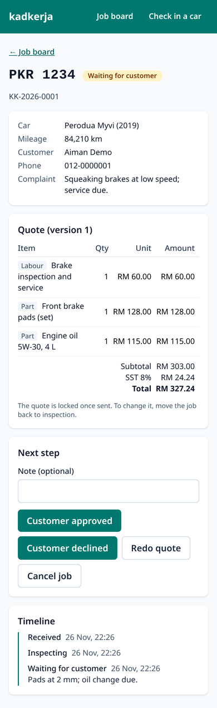
</p>

## What it does (so far)

### Staff sign-in and roles

Staff sign in with a username and password (demo: `advisor` or `tech`, password `demo-kadkerja`; demo profile
only). Two roles:

| | Service advisor | Technician |
| --- | --- | --- |
| See the board and job cards | yes | yes |
| Check in a car, make a new customer link | yes | no |
| Give a car to a technician (or take it back) | yes | no |
| Add or remove quote lines (while inspecting) | yes | on their own or unassigned cars |
| Moves | all | start inspection, start the approved repair, mark it ready (own or unassigned cars) |
| *My jobs*: own cars, to work on / waiting | - | yes |
| *Staff*: add people, deactivate / reactivate, set a new password | yes | no |
| *My password*: change own password | yes | yes |

A technician can open any job card but changes only cars assigned to them or to nobody; starting work on an
unassigned car makes it theirs. Only an active technician can be given a car, and a collected or cancelled job
keeps whoever worked on it. The server enforces all of this (`403`/`409` with the reason); the web app only
hides what the person cannot use.

<p>
  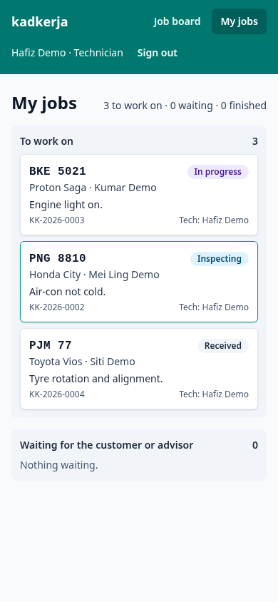
</p>

<p>
  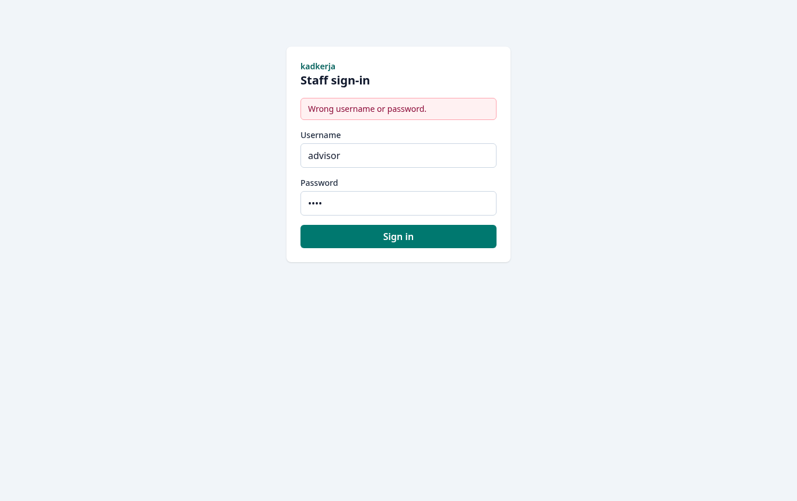
  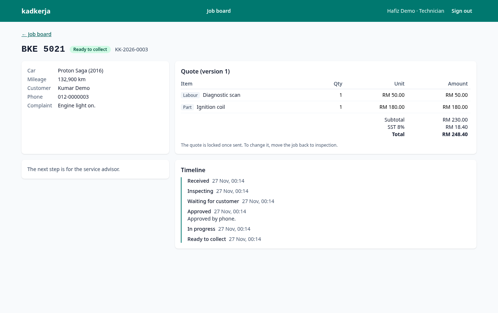
</p>

- **Session cookie** (HttpOnly, SameSite=Lax, 12 h), a new session id at sign-in, sign-out ends it.
- **CSRF**: every change sends the `XSRF-TOKEN` cookie back as the `X-XSRF-TOKEN` header; the token is replaced at
  sign-in. The customer link has no session and needs none.
- **Password guessing**: 5 failed sign-ins for one username from one address (or 20 from one address) block
  sign-in from there for 15 minutes, even with the right password. Unknown user, wrong password and a disabled
  account all get the same answer, and an unknown user still costs a password hash, so timing does not tell
  which usernames exist. Passwords are stored as bcrypt hashes only.
- **Staff management**: the advisor adds people (username, name, role, a first password of 12+ characters and at most
  72 bytes, since bcrypt ignores the rest), deactivates and reactivates them, and sets a new password when someone
  forgets theirs. Nobody is deleted, so names stay on old jobs. Nobody can deactivate themselves, and the last
  active advisor cannot be deactivated (the active advisors are row-locked while checking, so two advisors cannot
  deactivate each other at the same moment). A deactivated technician's open jobs go back to *nobody*.
- **Sessions end when the account changes**: each account has a session counter that goes up when it is
  deactivated or gets a new password; a session signed in before that is dropped at its next request (`401`, the
  app shows sign-in). Changing your own password (current password required, wrong guesses count towards the
  sign-in limit) keeps that session and ends the others.

<p>
  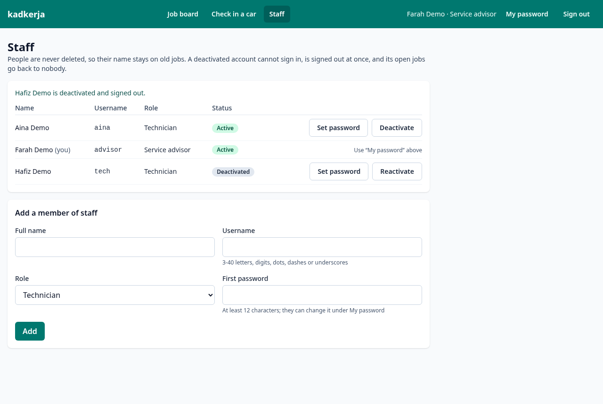
</p>

- **No default password on a real install**: on an empty database, set `KADKERJA_ADMIN_PASSWORD` (12+ characters)
  once to create the advisor `admin`. Without it nobody can sign in. Over HTTPS also set
  `server.servlet.session.cookie.secure=true`.

### Customer progress link (no login)

The front desk sends one link on WhatsApp. The customer opens it on their phone, sees where the car is and the
quote, and taps **Approve** or **Decline** (with an optional reason). No app, no account.

<p>
  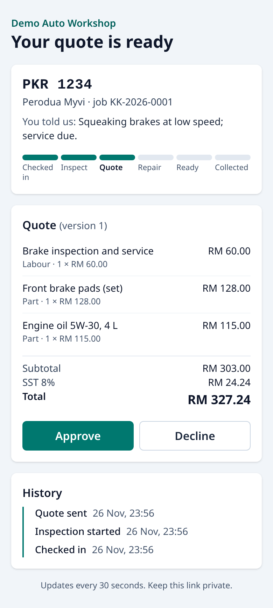
  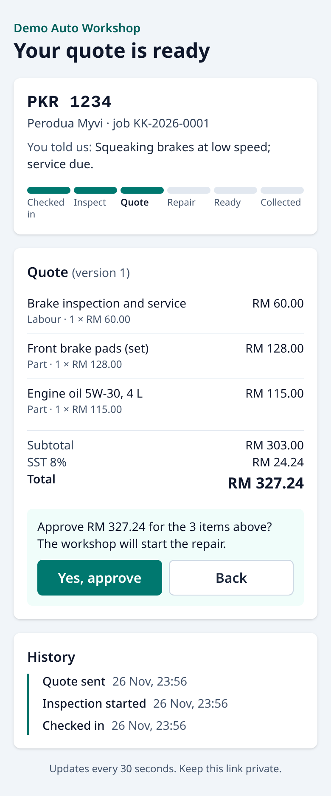
  
</p>

- **Stale-quote guard**: the answer carries the quote version the page showed. If the workshop redid the quote
  in the meantime (or is redoing it right now), the answer is refused and the page reloads with the new quote,
  so nobody approves a price they never saw. A second tap (or a replayed request) cannot move the job again.
- **Shows less than the staff view**: no customer name or phone, no internal ids, no staff notes, and no draft
  quote: lines appear only once the quote has been sent.
- **The link is the only key**, so it is treated like one: 144 random bits (24 URL-safe characters, from
  `SecureRandom`); anything else in the path is a 404 without touching the database; unknown and expired links
  get the same 404; the link stops working 30 days after the car is collected or the job cancelled; staff can
  make a **new link** at any time (the old one stops working at once); responses are `Cache-Control: no-store`,
  `Referrer-Policy: no-referrer` and `X-Robots-Tag: noindex`; and each client gets 60 reads and 10 answers per
  minute (`429` with `Retry-After` after that). The limit is in memory per server, keyed on the connection's
  address: behind a reverse proxy, turn on Spring's forwarded-header support first (the Docker Compose setup does).
- **Staff side**: the job card shows the link with *Send on WhatsApp* (a `wa.me` link with a message that fits
  the status, e.g. the total for a quote), *Copy link* and *New link*. Moves the customer made are marked
  "by customer (link)" in the timeline.


### Staff web app (React)

- **Job board**: open job cards in four columns in workshop order (checked in, waiting for customer, in the
  workshop, ready to collect), with a count per column; collected and cancelled jobs drop off the board.
- **Check in a car**: one form for customer, car and complaint. The server's message for each field is shown
  next to that field (and linked to it for screen readers), and a refused check-in (a car that already has an
  open job card) says why.
- **Job card page**: car and customer, the quote with SST and total, a form to add labour or part lines (prices
  typed as `45`, `45.50` or `RM 1,200`; anything else is refused before it reaches the server), remove lines,
  the next-step buttons the server allows (forward steps first, *Redo quote*, then *Cancel job*), an optional
  note per step, and the timeline in Malaysian time. Once the quote is sent it is locked, and the page says how
  to change it.

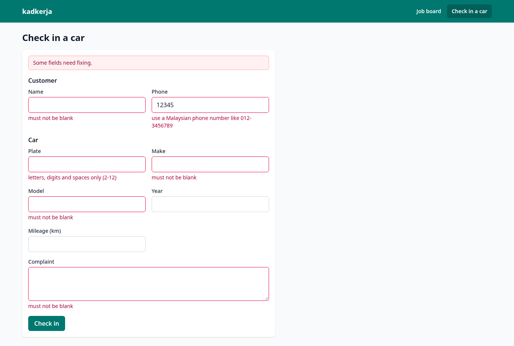

### Parts stock

- **Parts page** (everyone can look; the service advisor changes it): part number, name, price and the count on
  the shelf, marked *Low* at or below its reorder level, and *N to order* when the count is below zero.
- **Quote lines from stock**: *From stock* on the quote form fills in the part's name and price (both can still
  be changed) and links the line to the part. Labour lines never take a part.
- **Counted down on approval, once**: when the quote is approved, by the customer on their link or by the
  advisor (*Customer approved* after a phone call), every stock line comes off the shelf in the same database
  transaction as the approval. Sending, redoing, declining or cancelling a quote takes nothing, and an approved
  job cannot be approved again. Approval is never refused for an empty shelf: the count goes below zero and the
  page shows how many to order.
- **No lost counts**: the parts are locked in id order while they are counted down, so two approvals at the same
  moment wait for each other (tested with six approvals at once); each part also has a version check.
- **History**: every change is written down (first count, delivery received, stocktake difference, taken for
  job KK-...), with who did it ("customer approved" when it came from the link).

<p>
  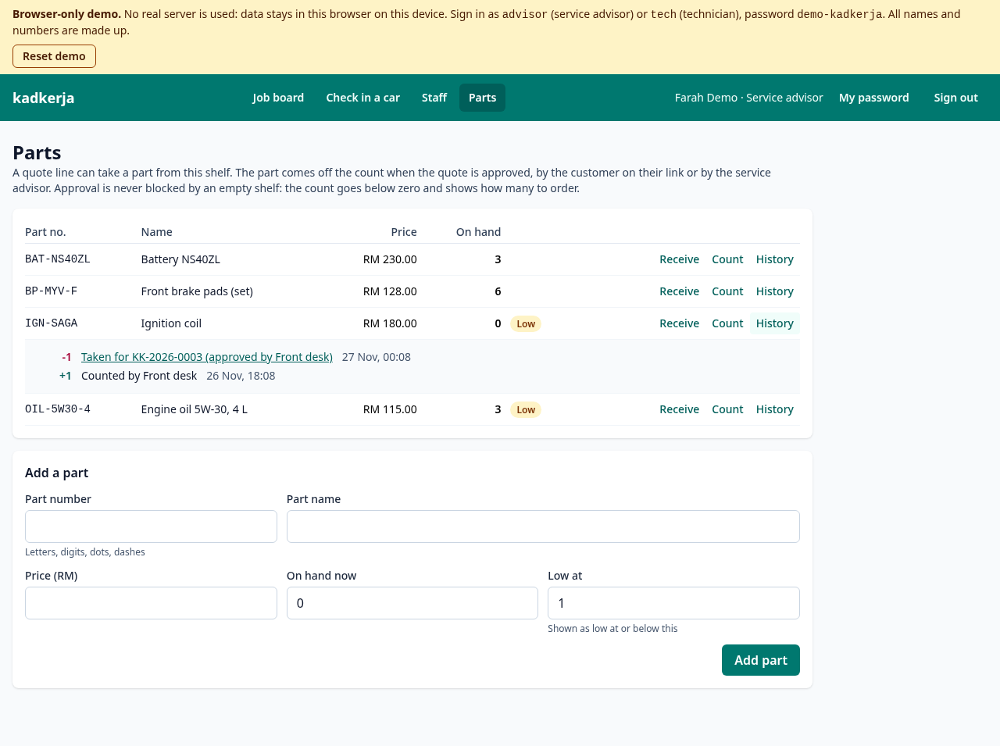
  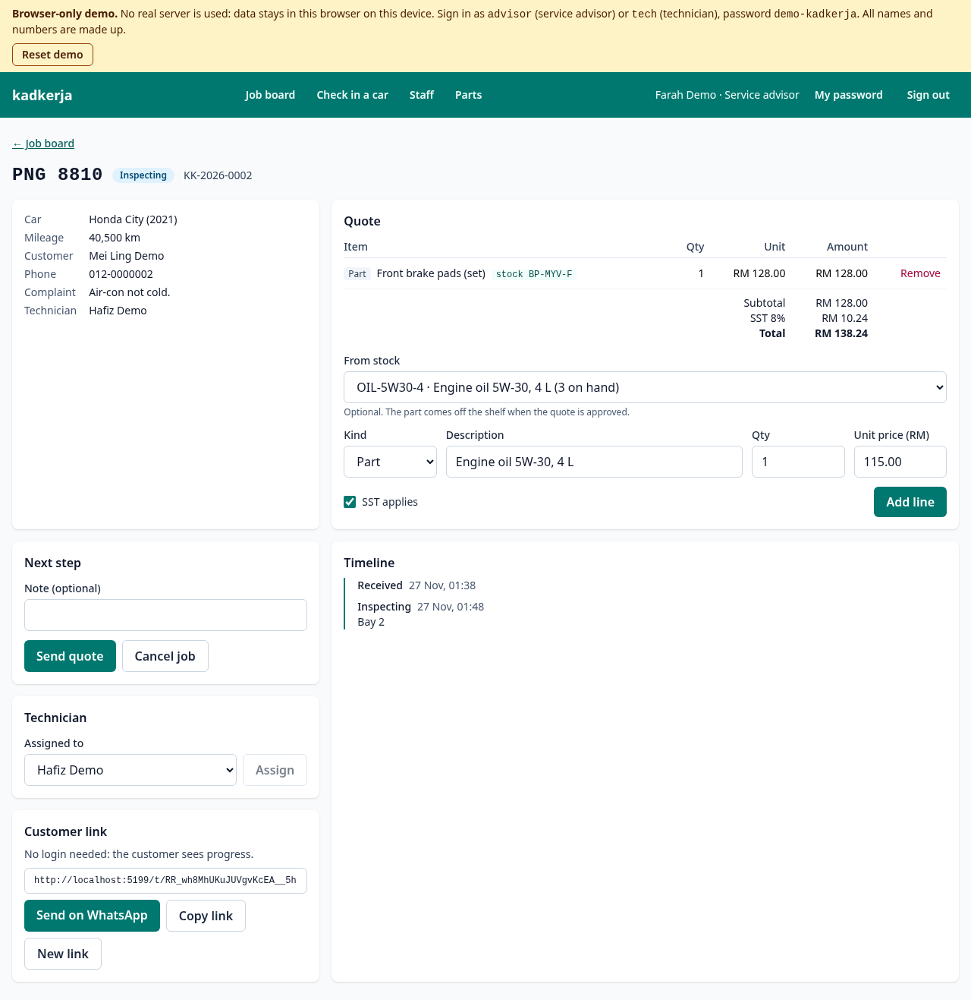
</p>

### Before and after photos

- **On the job card**: staff add *before* photos (the damage, the worn part) at any point and *after* photos
  once the repair has started, each with an optional caption. Tap one to see it large, with who added it and
  when. A technician adds and removes photos only on their own or an unassigned car; a collected or cancelled
  job's photos no longer change. At most 12 photos per job card.
- **On the customer's link**: the customer sees the same photos under *Photos from the workshop*, so a quote
  for new brake pads comes with a picture of the old ones.
- **Small and clean**: the browser shrinks a phone photo before sending it. The server then accepts only real
  JPEG or PNG bytes (it looks at the bytes, not the file name or type), refuses anything over 4 MB or 50 million
  pixels before decoding it, decodes a big photo at a fraction of its size (so one upload stays within about
  40 MB of memory), and stores a new JPEG of at most 1600 px. Camera metadata (location, phone model) is not
  copied into it.
- **Stored in the database**, not in files, so there are no paths to escape from. Images are sent with
  `Content-Security-Policy: default-src 'none'; sandbox` and `nosniff`. The customer's link reaches a photo by a
  random 16-character key that only works with that job's link; staff URLs use ids and need a session.
- Two uploads at the same moment cannot take a job past 12 (the job card's version is bumped on every upload,
  tested with uploads racing for the last place).
- Known gap: the browser turns a phone photo upright while shrinking it; a photo that reaches the server
  unshrunk (an old browser, or a direct API call) keeps its pixels as stored, so a sideways camera photo stays
  sideways.
- In the browser demo photos stay in localStorage, so they are limited to about 450 KB each and 1.5 MB in all.

<p>
  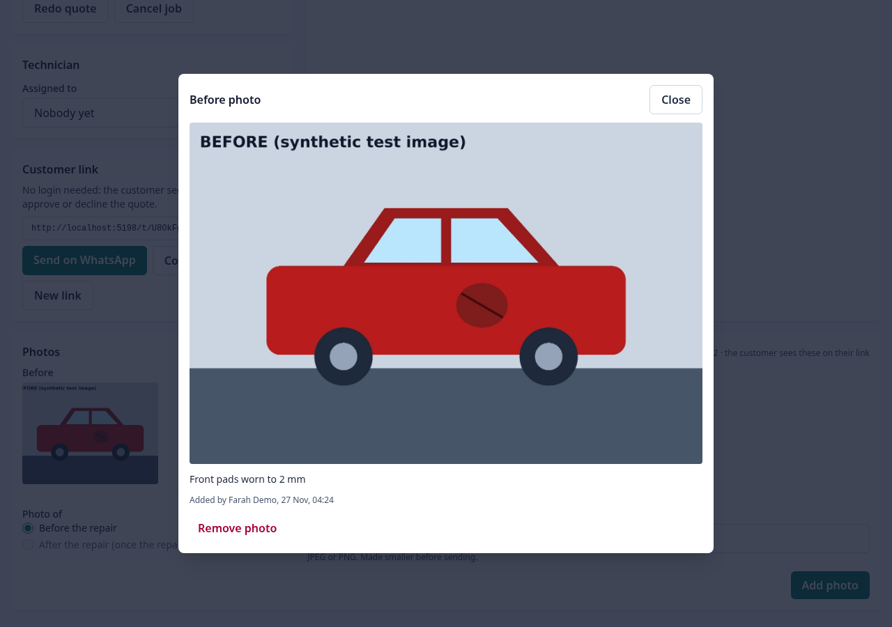
  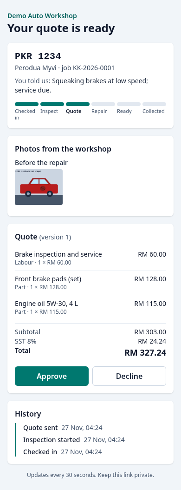
</p>

### API (Spring Boot)


- **Check-in**: customer, car and complaint in one request. Plates are normalised however they are typed
  (`pkr1234`, `PKR  1234` -> `PKR 1234`), a known plate reuses the car, a different phone number means the car
  has a new owner (phone numbers compare by digits, so `012-345 6789` = `0123456789`), an old job card keeps
  the customer who brought the car that time, and a car can only have one open job card at a time.
- **Job card flow, enforced on the server**:

  ```
  RECEIVED -> INSPECTING -> QUOTED -> APPROVED -> IN_PROGRESS -> READY -> COLLECTED
                  ^            |
                  +- redo -----+-> DECLINED -> READY (car returned unrepaired)
  CANCELLED from RECEIVED, INSPECTING or QUOTED
  ```

  Every other move is refused with a message that says why. Each move is kept with its time and an optional note
  (the timeline), with who made it (staff, or the customer through the link). The API returns the moves allowed next, so a UI never has to repeat the rules.
- **Quotes**: labour and part lines in whole sen (no floating point), quantity x unit price, SST on taxable lines
  (rate is a setting, 8% by default; illustrative, not tax advice), rounded half up per line. The quote can only
  be changed before it is sent; sending it again after a redo bumps the quote version (so an approval of an old
  quote is refused). A quote cannot be sent with no lines.
- **Errors** are RFC 9457 `application/problem+json`: `409` for a rule (with the reason), `404`, and `400` with
  a message per field. Concurrent edits are caught with optimistic locking.
- Each job card gets an unguessable token for the customer's progress link. It is in the job card (so staff
  can send it) but never in the board list.

## API

Everything under `/api/jobs`, `/api/parts` and `/api/staff` needs a signed-in session (and the CSRF header for changes); `/api/public/...` does not.

| Method | Path | What |
| --- | --- | --- |
| `GET` | `/api/auth/csrf` | CSRF token (also set as the `XSRF-TOKEN` cookie) |
| `POST` | `/api/auth/login` | Sign in `{username, password}` -> who and which role |
| `GET` | `/api/auth/me` | Who is signed in (`401` if nobody) |
| `POST` | `/api/auth/logout` | Sign out (`204`) |
| `GET` | `/api/jobs?status=QUOTED` | Job board rows with the assigned technician, newest first (optional status filter) |
| `GET` | `/api/jobs?mine=true` | Job cards assigned to the signed-in person |
| `POST` | `/api/jobs` | Check in a car (creates the job card) |
| `GET` | `/api/jobs/{id}` | Job card with vehicle, customer, quote lines, totals, timeline, next moves |
| `POST` | `/api/jobs/{id}/lines` | Add a quote line `{kind: LABOUR/PART, description, quantity, unitPriceSen, taxable, partId?}` |
| `DELETE` | `/api/jobs/{id}/lines/{lineId}` | Remove a quote line |
| `POST` | `/api/jobs/{id}/moves` | Move the job `{to, note?}` |
| `POST` | `/api/jobs/{id}/link` | Make a new customer link (the old one stops working) |
| `PUT` | `/api/jobs/{id}/assignee` | Advisor: give the job to a technician `{staffId}` (`null` = nobody) |
| `GET` | `/api/jobs/{id}/photos` | Photos of the job (id, stage, size, caption, who, when) |
| `POST` | `/api/jobs/{id}/photos` | Add a photo: `multipart/form-data` with `stage` (BEFORE/AFTER), `file` (JPEG or PNG, at most 4 MB), `caption?` |
| `GET` | `/api/jobs/{id}/photos/{photoId}` | The stored JPEG |
| `DELETE` | `/api/jobs/{id}/photos/{photoId}` | Remove a photo (`204`) |
| `GET` | `/api/parts` | The parts shelf (part number, name, price, on hand, reorder level, low) |
| `POST` | `/api/parts` | Advisor: add a part `{sku, name, unitPriceSen, onHand, reorderLevel}` |
| `POST` | `/api/parts/{id}/receive` | Advisor: a delivery arrived `{quantity}` |
| `POST` | `/api/parts/{id}/count` | Advisor: stocktake `{onHand}` (the difference is written down) |
| `GET` | `/api/parts/{id}/movements` | Last 50 changes to a part, newest first |
| `GET` | `/api/staff` | Advisor: staff list (id, username, name, role, active; never password hashes) |
| `POST` | `/api/staff` | Advisor: add someone `{username, name, role, password}` |
| `POST` | `/api/staff/{id}/deactivate` | Advisor: stop them signing in, end their sessions, hand back their open jobs |
| `POST` | `/api/staff/{id}/activate` | Advisor: let them sign in again |
| `POST` | `/api/staff/{id}/password` | Advisor: set a new password for someone else `{password}` (ends their sessions) |
| `POST` | `/api/auth/password` | Change my own password `{currentPassword, newPassword}` (`204`; other sessions end) |
| `GET` | `/api/public/jobs/{token}` | Customer view: progress, sent quote, whether it can be answered |
| `GET` | `/api/public/jobs/{token}/photos/{key}` | Customer: one photo of this job, by its random key |
| `POST` | `/api/public/jobs/{token}/answer` | Customer answer `{decision: APPROVE/DECLINE, quoteVersion, note?}` |

```bash
curl -s -b cookies localhost:8080/api/jobs/1   # after signing in with that cookie jar
# {"id":1,"number":"KK-2026-0001","status":"QUOTED","next":["INSPECTING","APPROVED","DECLINED","CANCELLED"],
#  "vehicle":{"plate":"PKR 1234","make":"Perodua","model":"Myvi",...},"subtotalSen":30300,"taxSen":2424,
#  "totalSen":32724,"sstRatePercent":8,"events":[...]}
```

## Run it

Needs Java 21 and Node 24. No database setup for trying it: the API uses in-memory H2 (PostgreSQL mode) by
default.

```bash
cd backend
./mvnw spring-boot:run -Dspring-boot.run.profiles=demo   # API on :8080 with made-up demo jobs and staff
                                                          # (advisor / tech, password demo-kadkerja)
                                                          # (logs a customer link for the quoted demo job)
./mvnw verify                                             # backend tests

cd frontend
npm install
npm run dev                                               # http://localhost:5173 (proxies /api to :8080)
npm test                                                  # frontend tests

npm run dev:demo                                          # the browser-only demo (no backend needed)
npm run build:demo                                        # -> frontend/dist-demo (static files)
npm run deploy:demo                                       # Cloudflare Worker with static assets
                                                          # (wrangler.demo.jsonc; needs Cloudflare credentials)
```

The demo build is a separate Vite mode (`--mode demo`). In the normal build the demo branch in `main.tsx` is
dead code and is dropped; a test builds both and checks that the normal build has no demo code or demo password.

With PostgreSQL: create a database and run with the `postgres` profile (`DB_URL`, `DB_USER`, `DB_PASSWORD`;
defaults `jdbc:postgresql://localhost:5432/kadkerja`, `kadkerja`/`kadkerja` for local use only). Flyway creates
the schema.

### With Docker Compose (PostgreSQL + API + web app)

Needs only Docker. One command builds and starts PostgreSQL 17, the Spring Boot API and the web app (served by
nginx, which also passes `/api` to the API):

```bash
KADKERJA_PROFILES=postgres,demo docker compose up --build   # with the made-up demo cars and staff
                                                           # (advisor / tech, password demo-kadkerja)
# open http://localhost:8081

KADKERJA_ADMIN_PASSWORD='choose-12-or-more' docker compose up --build   # an empty workshop; sign in as admin
docker compose down        # stop (data stays in the db-data volume)
docker compose down -v     # stop and delete the data
```

- Only the web container is published, and only on this machine (`127.0.0.1:8081`; change the port with
  `KADKERJA_PORT`). The API and the database are reachable from inside the Compose network only. To open the
  customer link on a phone on the same Wi-Fi, publish the port on your LAN address instead - and then set your own
  `KADKERJA_DB_PASSWORD` and admin password, and never use the demo profile.
- nginx **overwrites** `X-Forwarded-For` with the real client address and the API reads it
  (`SERVER_FORWARD_HEADERS_STRATEGY=native`), so the sign-in limit and the customer-link rate limit count each
  client, not the proxy, and a made-up header cannot get around them.
- nginx adds `X-Content-Type-Options`, `X-Frame-Options: DENY` and `Referrer-Policy: no-referrer` (the customer
  link has its key in the URL), caches the hashed files under `/assets` for a year and allows 6 MB request bodies
  (the API itself limits photos to 4 MB).
- No HTTPS here: for a real server put it behind a TLS proxy, set `SERVER_SERVLET_SESSION_COOKIE_SECURE=true` on
  the API, and let nginx pass on that proxy's `X-Forwarded-For` (otherwise every client looks like the TLS proxy).
- CI builds and starts this stack on every push and runs [`scripts/compose-smoke.sh`](scripts/compose-smoke.sh)
  against it: the app and its routes, sign-in with the CSRF cookie, demo data read from PostgreSQL, a fake
  `X-Forwarded-For` that must not get around the sign-in limit, and a restart that keeps the data.

## How it is built

- Java 21, Spring Boot 4.2 (Spring MVC, Spring Security, Data JPA, Bean Validation, Flyway), PostgreSQL 17 / H2.
- React 19 + TypeScript + Vite, React Router, TanStack Query (every change returns the whole job card, which
  replaces the cached one; the board is refreshed), Tailwind CSS. Status labels, button texts and board columns
  live in one file (`frontend/src/status.ts`); the allowed moves always come from the server.
- The rules live in the domain (`JobStatus`, `JobCard`): every change goes through methods that check them, so
  no caller can skip a step. Views are built inside the service transaction (`open-in-view` is off).
- Backend tests (98): every one of the 81 status pairs is checked against an independent table, every status is
  reachable and none is a dead end; 2,000 random quotes add up exactly (lines, tax, total) and per-line tax is
  never more than half a sen off; the whole flow through the HTTP API with MockMvc; refused moves and edits
  change nothing; field-by-field validation; plate reuse, owner changes and the one-open-job rule; the token never leaks; demo
  data seeds once. Customer link: tokens are 24 URL-safe characters and do not repeat; approve, decline, the
  stale-quote and double-answer refusals; one job's token cannot read or answer another job; draft quotes,
  names, phones and staff notes never reach the public view; malformed, unknown, reset and expired links; the
  rate limit per client and per kind, with the staff API unaffected; and a database written by the previous
  schema version migrates with its old timeline intact. Sign-in through the real HTTP API with no mock users:
  `401` without a session while the customer link stays open, a new session id at sign-in, the same answer for
  wrong password / unknown user / disabled account, the guessing limit (also unit-tested with a clock), CSRF
  refused when missing or mismatched and accepted the browser's way (cookie -> header, new token after
  sign-in), sign-in itself needs the token, an overlong password is just wrong, the first-admin bootstrap, sign-out, and what a technician may and may not do (every
  status pair checked). Assignment with real sign-ins: only an active technician and only by the advisor, my jobs,
  taking a car back, a finished job keeps its technician, another technician's car is refused for moves and quote
  lines, starting an unassigned car takes it (a refused move does not), and the staff list has no hashes. Staff
  management: adding (lower-cased username, taken username, short and over-72-byte passwords, bad role, advisor
  only), deactivating ends the person's live session and refuses sign-in while the customer link keeps working in
  that browser, open jobs handed back and finished ones kept, reactivating, no self-deactivation, the last-advisor
  rule, a new password from the advisor ends old sessions, changing your own keeps this session and ends the others,
  and guessing the current password is limited. A V3-era account migrates with session counter 0. Parts stock:
  advisor-only changes, part number rules, taken part numbers in any letter case, receive and stocktake
  history; a part only on a part line; approval by the customer or the advisor counts down once (several lines of
  one part added up), declined, cancelled and redone quotes take nothing, a short shelf goes below zero, the
  customer view shows no part ids, six approvals at the same moment lose no count (fails without the row lock),
  and old quote lines migrate with no part. Photos (synthetic images made in the test): a large photo comes back
  as a JPEG of at most 1600 px with the same shape, camera metadata is dropped, transparent areas turn white, an SVG
  or a PNG sent as `photo.jpg` / `image/jpeg` is judged by its bytes (the SVG refused, the PNG stored as JPEG), no CSRF token is refused, a header claiming a huge picture is refused
  before decoding, a big photo is decoded subsampled, a request over 4 MB gets `413`; after photos only once the repair started, finished jobs locked,
  technicians only on their own or unassigned cars, 12 at most (also with uploads racing for the last place;
  fails without the version bump), a photo only through its own job, and the customer only by key on their own
  link.
- Frontend tests (113, Vitest + Testing Library against a fake `fetch`): board columns and empty/error states;
  check-in request body, per-field server errors with `aria-invalid` and descriptions, refused and unreachable
  server; job card totals, adding a line sends the price in sen, an unreadable price never reaches the server,
  removing a line, moving with a trimmed note, button order, the quote locking after sending, a refused move
  keeps the card as it was, finished and unknown jobs; the customer page (no staff navigation, approve/decline only after confirming and
  with the version shown, a changed quote is explained and reloaded, hidden draft quote, expired link, a confirmation closes if a newer quote arrives), the
  WhatsApp message and number format, and *New link* only after confirming; sign-in (wrong then right password,
  the CSRF header on sign-in and on changes, back to the form when the session ends, sign-out really shows the
  form again) and the technician's view (no check-in, no customer link, only workshop moves); assigning a technician (only active
  technicians offered, one who has left still shown, unassign), another technician's car is read-only, *My jobs*
  order and empty state, who has each car on the board; the Staff page (own row without buttons, add with a taken
  username shown on the field, deactivate only after confirming, set a password with the server's check on the
  field, hidden from technicians) and *My password* (repeat checked before sending, wrong current password); the Parts
  page (to-order and low marks, read-only for technicians, history linking to the job, receive and stocktake with
  checks before sending, add with a taken part number on the field) and *From stock* on the quote form (fills the
  line, sends the part id, labour drops it). Photos: before and after shown apart, the large view with caption and
  who, removing only after confirming, the upload as multipart with stage, caption and the CSRF header, a file
  that is not a JPEG or PNG refused before sending, after photos offered only once the repair started, no upload
  form on finished jobs, someone else's car or a full card; the customer's photos. Price parsing round-trips every formatted amount.
  Browser demo: the in-browser stand-in's sign-in, seed totals, the whole check-in -> quote -> customer approval
  flow, the stale-quote and double-answer refusals, technician limits and assignment rules, staff management rules, the parts shelf and its count-down on approval, photos (the same rules as the server, the storage limits, a
  full browser storage refused with nothing changed), form checks, what the customer link hides,
  new links; the whole app signing in and approving on it, *My jobs*, adding a technician who then signs in; an old or damaged saved demo starts again; reset; and both builds (the real one without demo code).
- GitHub Actions on every push and pull request: backend tests on H2 and again on a real PostgreSQL 17 service
  (Flyway migration + API tests), the frontend's lint (oxlint), typecheck, tests and build, and the Docker Compose
  stack built, started and smoke-tested through nginx.

## Roadmap

1. ✅ Backend: job cards, status flow, quotes with SST, REST API, validation, tests on H2 and PostgreSQL, CI.
2. ✅ React + TypeScript staff web app: job board by status, check-in form, job card page with quote editor.
3. ✅ Customer progress link (no login): timeline, quote, approve/decline with a stale-quote guard, WhatsApp text.
4. ✅ Staff sign-in (Spring Security; advisor and technician roles), technician assignment, "My jobs", staff
   management (add, deactivate/reactivate, set and change passwords; sessions end when an account changes).
5. ✅ Parts stock deducted on approval, before/after photos per job card.
6. Docker Compose ✅ (PostgreSQL + API + nginx, started and smoke-tested in CI); next: Bahasa Melayu and 简体中文,
   accessibility pass, Playwright end-to-end tests, demo GIF.

## Privacy

All names, phone numbers and plates in the demo data and tests are made up.

## License

MIT
