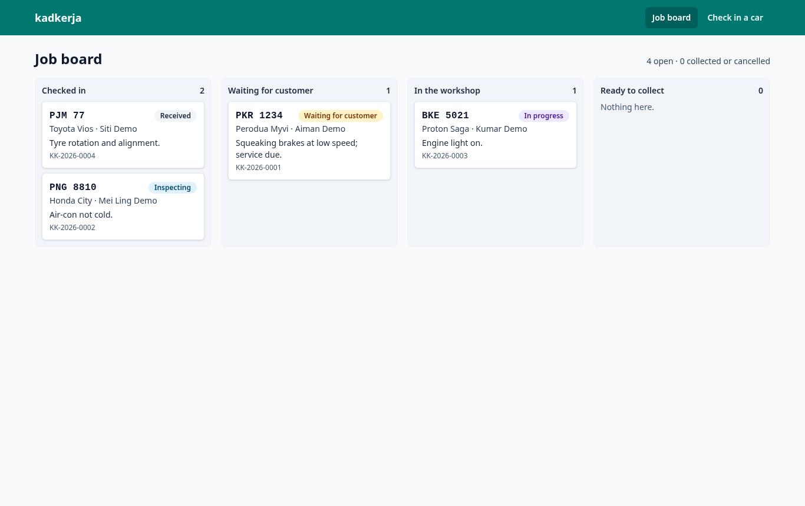
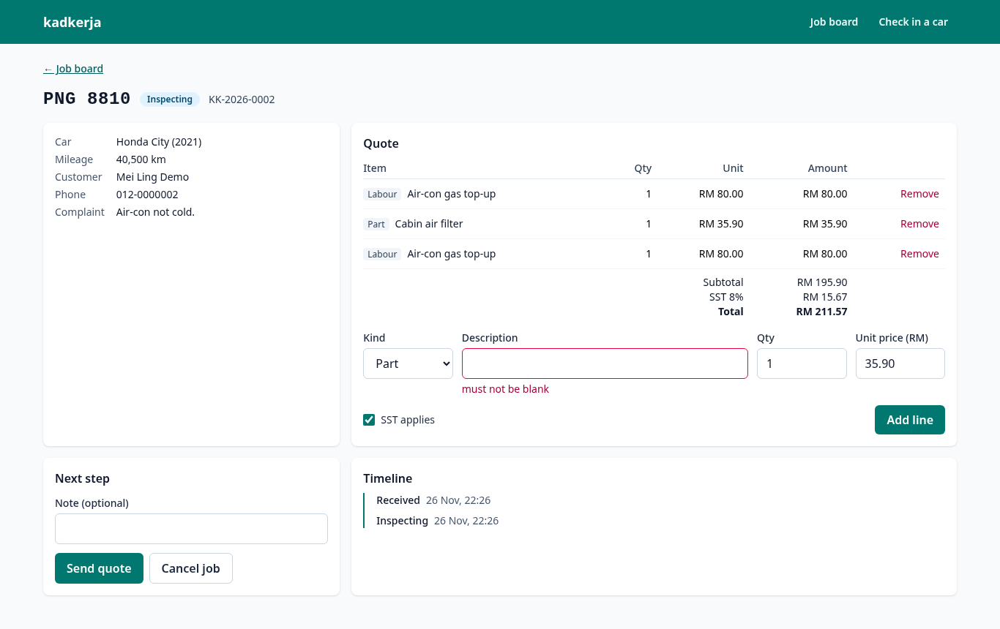
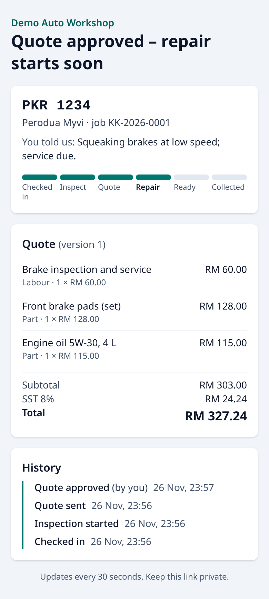
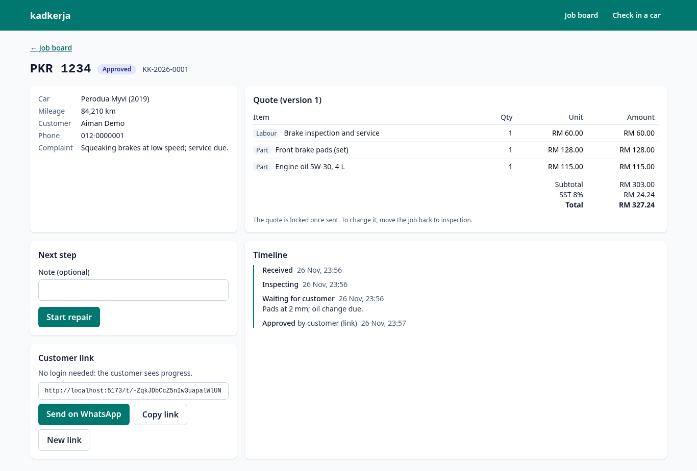

# kadkerja

**Job cards for a small car workshop: check-in, quote, approval, repair, collection.**

*Kad kerja* is Malay for "job card". Many small workshops still run on handwritten job cards and WhatsApp:
the front desk writes down the complaint, the mechanic finds the problem, someone phones the customer with a
price, and nobody is quite sure which car is waiting for what. kadkerja is a web system for that workshop.

Status: **work in progress** (increments 1-3 of 6: the API, the staff web app and the customer's progress link).
No staff login yet (increment 4), so do not put it on the internet yet. Plan in [Roadmap](#roadmap).

<p>
  
</p>
<p>
  
  
</p>

## What it does (so far)

### Customer progress link (no login)

The front desk sends one link on WhatsApp. The customer opens it on their phone, sees where the car is and the
quote, and taps **Approve** or **Decline** (with an optional reason). No app, no account.

<p>
  
  
  
</p>

- **Stale-quote guard**: the answer carries the quote version the page showed. If the workshop redid the quote
  in the meantime (or is redoing it right now), the answer is refused and the page reloads with the new quote,
  so nobody approves a price they never saw. A second tap (or a replayed request) cannot move the job again.
- **Shows less than the staff view**: no customer name or phone, no internal ids, no staff notes, and no draft
  quote: lines appear only once the quote has been sent.
- **The link is the only key**, so it is treated like one: 144 random bits (24 URL-safe characters, from
  `SecureRandom`); anything else in the path is a 404 without touching the database; unknown and expired links
  get the same 404; the link stops working 30 days after the car is collected or the job cancelled; staff can
  make a **new link** at any time (the old one stops working at once); responses are `Cache-Control: no-store`,
  `Referrer-Policy: no-referrer` and `X-Robots-Tag: noindex`; and each client gets 60 reads and 10 answers per
  minute (`429` with `Retry-After` after that). The limit is in memory per server, keyed on the connection's
  address: behind a reverse proxy, turn on Spring's forwarded-header support first.
- **Staff side**: the job card shows the link with *Send on WhatsApp* (a `wa.me` link with a message that fits
  the status, e.g. the total for a quote), *Copy link* and *New link*. Moves the customer made are marked
  "by customer (link)" in the timeline.



### Staff web app (React)

- **Job board**: open job cards in four columns in workshop order (checked in, waiting for customer, in the
  workshop, ready to collect), with a count per column; collected and cancelled jobs drop off the board.
- **Check in a car**: one form for customer, car and complaint. The server's message for each field is shown
  next to that field (and linked to it for screen readers), and a refused check-in (a car that already has an
  open job card) says why.
- **Job card page**: car and customer, the quote with SST and total, a form to add labour or part lines (prices
  typed as `45`, `45.50` or `RM 1,200`; anything else is refused before it reaches the server), remove lines,
  the next-step buttons the server allows (forward steps first, *Redo quote*, then *Cancel job*), an optional
  note per step, and the timeline in Malaysian time. Once the quote is sent it is locked, and the page says how
  to change it.


### API (Spring Boot)


- **Check-in**: customer, car and complaint in one request. Plates are normalised however they are typed
  (`pkr1234`, `PKR  1234` -> `PKR 1234`), a known plate reuses the car, a different phone number means the car
  has a new owner (phone numbers compare by digits, so `012-345 6789` = `0123456789`), an old job card keeps
  the customer who brought the car that time, and a car can only have one open job card at a time.
- **Job card flow, enforced on the server**:

  ```
  RECEIVED -> INSPECTING -> QUOTED -> APPROVED -> IN_PROGRESS -> READY -> COLLECTED
                  ^            |
                  +- redo -----+-> DECLINED -> READY (car returned unrepaired)
  CANCELLED from RECEIVED, INSPECTING or QUOTED
  ```

  Every other move is refused with a message that says why. Each move is kept with its time and an optional note
  (the timeline), with who made it (staff, or the customer through the link). The API returns the moves allowed next, so a UI never has to repeat the rules.
- **Quotes**: labour and part lines in whole sen (no floating point), quantity x unit price, SST on taxable lines
  (rate is a setting, 8% by default; illustrative, not tax advice), rounded half up per line. The quote can only
  be changed before it is sent; sending it again after a redo bumps the quote version (so an approval of an old
  quote is refused). A quote cannot be sent with no lines.
- **Errors** are RFC 9457 `application/problem+json`: `409` for a rule (with the reason), `404`, and `400` with
  a message per field. Concurrent edits are caught with optimistic locking.
- Each job card gets an unguessable token for the customer's progress link. It is in the job card (so staff
  can send it) but never in the board list.

## API

| Method | Path | What |
| --- | --- | --- |
| `GET` | `/api/jobs?status=QUOTED` | Job board rows, newest first (optional status filter) |
| `POST` | `/api/jobs` | Check in a car (creates the job card) |
| `GET` | `/api/jobs/{id}` | Job card with vehicle, customer, quote lines, totals, timeline, next moves |
| `POST` | `/api/jobs/{id}/lines` | Add a quote line `{kind: LABOUR/PART, description, quantity, unitPriceSen, taxable}` |
| `DELETE` | `/api/jobs/{id}/lines/{lineId}` | Remove a quote line |
| `POST` | `/api/jobs/{id}/moves` | Move the job `{to, note?}` |
| `POST` | `/api/jobs/{id}/link` | Make a new customer link (the old one stops working) |
| `GET` | `/api/public/jobs/{token}` | Customer view: progress, sent quote, whether it can be answered |
| `POST` | `/api/public/jobs/{token}/answer` | Customer answer `{decision: APPROVE/DECLINE, quoteVersion, note?}` |

```bash
curl -s localhost:8080/api/jobs/1
# {"id":1,"number":"KK-2026-0001","status":"QUOTED","next":["INSPECTING","APPROVED","DECLINED","CANCELLED"],
#  "vehicle":{"plate":"PKR 1234","make":"Perodua","model":"Myvi",...},"subtotalSen":30300,"taxSen":2424,
#  "totalSen":32724,"sstRatePercent":8,"events":[...]}
```

## Run it

Needs Java 21 and Node 24. No database setup for trying it: the API uses in-memory H2 (PostgreSQL mode) by
default.

```bash
cd backend
./mvnw spring-boot:run -Dspring-boot.run.profiles=demo   # API on :8080 with made-up demo jobs
                                                          # (logs a customer link for the quoted demo job)
./mvnw verify                                             # backend tests

cd frontend
npm install
npm run dev                                               # http://localhost:5173 (proxies /api to :8080)
npm test                                                  # frontend tests
```

With PostgreSQL: create a database and run with the `postgres` profile (`DB_URL`, `DB_USER`, `DB_PASSWORD`;
defaults `jdbc:postgresql://localhost:5432/kadkerja`, `kadkerja`/`kadkerja` for local use only). Flyway creates
the schema.

## How it is built

- Java 21, Spring Boot 4.2 (Spring MVC, Data JPA, Bean Validation, Flyway), PostgreSQL 17 / H2.
- React 19 + TypeScript + Vite, React Router, TanStack Query (every change returns the whole job card, which
  replaces the cached one; the board is refreshed), Tailwind CSS. Status labels, button texts and board columns
  live in one file (`frontend/src/status.ts`); the allowed moves always come from the server.
- The rules live in the domain (`JobStatus`, `JobCard`): every change goes through methods that check them, so
  no caller can skip a step. Views are built inside the service transaction (`open-in-view` is off).
- Backend tests (40): every one of the 81 status pairs is checked against an independent table, every status is
  reachable and none is a dead end; 2,000 random quotes add up exactly (lines, tax, total) and per-line tax is
  never more than half a sen off; the whole flow through the HTTP API with MockMvc; refused moves and edits
  change nothing; field-by-field validation; plate reuse, owner changes and the one-open-job rule; the token never leaks; demo
  data seeds once. Customer link: tokens are 24 URL-safe characters and do not repeat; approve, decline, the
  stale-quote and double-answer refusals; one job's token cannot read or answer another job; draft quotes,
  names, phones and staff notes never reach the public view; malformed, unknown, reset and expired links; the
  rate limit per client and per kind, with the staff API unaffected; and a database written by the previous
  schema version migrates with its old timeline intact.
- Frontend tests (33, Vitest + Testing Library against a fake `fetch`): board columns and empty/error states;
  check-in request body, per-field server errors with `aria-invalid` and descriptions, refused and unreachable
  server; job card totals, adding a line sends the price in sen, an unreadable price never reaches the server,
  removing a line, moving with a trimmed note, button order, the quote locking after sending, a refused move
  keeps the card as it was, finished and unknown jobs; the customer page (no staff navigation, approve/decline only after confirming and
  with the version shown, a changed quote is explained and reloaded, hidden draft quote, expired link, a confirmation closes if a newer quote arrives), the
  WhatsApp message and number format, and *New link* only after confirming. Price parsing round-trips every formatted amount.
- GitHub Actions on every push and pull request: backend tests on H2 and again on a real PostgreSQL 17 service
  (Flyway migration + API tests), and the frontend's lint (oxlint), typecheck, tests and build.

## Roadmap

1. ✅ Backend: job cards, status flow, quotes with SST, REST API, validation, tests on H2 and PostgreSQL, CI.
2. ✅ React + TypeScript staff web app: job board by status, check-in form, job card page with quote editor.
3. ✅ Customer progress link (no login): timeline, quote, approve/decline with a stale-quote guard, WhatsApp text.
4. Staff login (Spring Security; advisor and technician roles), technician assignment, "my jobs".
5. Before/after photos, parts stock deducted on approval.
6. Bahasa Melayu and 简体中文, accessibility pass, Docker Compose, Playwright end-to-end tests, demo GIF.

## Privacy

All names, phone numbers and plates in the demo data and tests are made up.

## License

MIT
